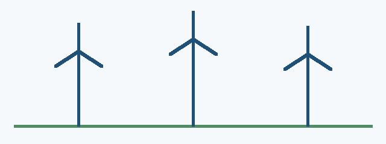

# 表图题注验证

本段验证 `anchor:section` 中的原生题注与旧题注兼容。

`anchor:begin:table`

| 月份 | 发电量 |
|------|--------|
| 一月 | 101 |
| 二月 | 202 |

Table: 表 9.9-7 月度统计

`anchor:end:table`

`anchor:begin:figure`

{width=10cm}

`anchor:end:figure`

`anchor:begin:table`

| 方案 | 指标 |
|------|------|
| A | 12 |

: 新表题

表 8.8-9 兼容旧表题

`anchor:end:table`

`anchor:begin:figure`

图 8.8-9 兼容旧图题

{width=10cm}

`anchor:end:figure`

`anchor:begin:table`

| 无题表 | 数值 |
|--------|------|
| A | 1 |

`anchor:end:table`

`anchor:begin:table`

| 独立对象 | 数值 |
|----------|------|
| A | 1 |

Table: 重复标题

`anchor:end:table`

`anchor:begin:table`

| 独立对象 | 数值 |
|----------|------|
| B | 2 |

Table: 重复标题

`anchor:end:table`

## 分节计数

`anchor:begin:table`

| 分节 | 数值 |
|------|------|
| A | 3 |

Table: 分节统计

`anchor:end:table`

### 深层计数共享

`anchor:begin:table`

| 层级 | 数值 |
|------|------|
| 深层 | 4 |

Table: 深层统计

`anchor:end:table`

`anchor:begin:landscape`

`anchor:begin:table`

| 方案 | 甲 | 乙 | 丙 |
|------|----|----|----|
| 横向 | 1 | 2 | 3 |

Table: 横向表

`anchor:end:table`

`anchor:begin:figure`

[{width=10cm}](https://example.com)

`anchor:end:figure`

`anchor:end:landscape`
